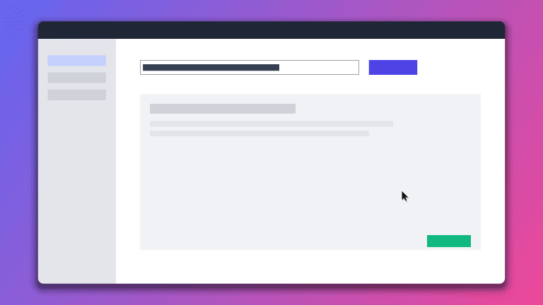
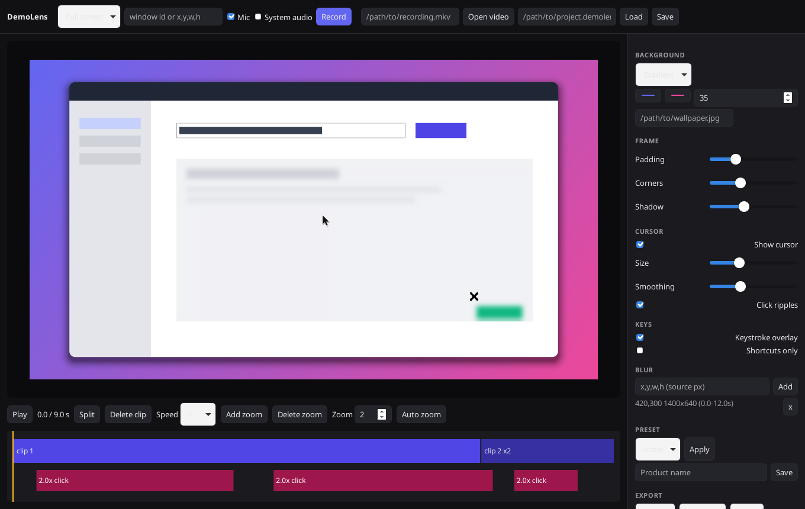

# DemoLens

DemoLens is a free, open source screen recorder for product demos. It is a local alternative to Screen Studio and Screen Charm that runs on Windows, macOS and Linux. Everything happens on your machine: no account, no upload, no internet connection.

You record your screen, DemoLens logs your cursor, clicks and key presses next to the video, and the editor turns that into a polished demo with smooth auto zoom, a nicer cursor, click ripples, a keystroke overlay and a styled background. Export to MP4 or GIF up to 4K in 16:9, 9:16 or 1:1.





## Features

- **Recording**: full screen, a single window or an area, with microphone and system audio where the OS allows it (see the capture table below).
- **Event log**: while recording, cursor moves, clicks and key presses are written to a timestamped `*.events.jsonl` file next to the video.
- **Auto zoom**: zoom segments are generated from clicks and typing bursts. The zoom eases in and out smoothly and follows the cursor. Every segment is visible on the timeline, where you can drag its edges, change its scale, delete it or add new ones.
- **Cursor**: cursor smoothing, a bigger cursor option and click highlight ripples. DemoLens hides the OS cursor while recording and draws its own, so it stays sharp at any zoom.
- **Keystroke overlay**: shows typed text and shortcuts such as `Ctrl + S`. Can be switched off or limited to shortcuts only.
- **Styling**: gradient, solid or image background, padding, rounded corners and a soft shadow.
- **Editing**: trim, split, delete pieces and set per clip speed (0.25x to 16x, audio follows).
- **Blur boxes**: hide private data with manual blur regions that move correctly with the zoom.
- **Product presets**: save a brand style per product (background, frame, cursor, keys) and reapply it to any recording.
- **Export**: MP4 (H.264 + AAC) or GIF (palette optimised), 720p to 4K, in 16:9, 9:16 or 1:1.

## How it works

```
 record                       edit                                   export
 ┌──────────────┐   video     ┌────────────────────────────────┐     ┌──────────────┐
 │ OS grabber   │──────────▶  │ project.json                   │     │ ffmpeg       │
 │ (via ffmpeg) │             │  clips, zoom, style, blur ...  │     │ libx264/gif  │
 └──────────────┘             └──────────────┬─────────────────┘     └──────▲───────┘
 ┌──────────────┐  events     ┌──────────────▼─────────────────┐  RGBA      │
 │ input hooks  │──────────▶  │ Renderer::render(frame, t)     │────────────┘
 │ (rdev)       │  .jsonl     │  one compositor in Rust        │──▶ PNG ──▶ editor preview
 └──────────────┘             └────────────────────────────────┘
```

The important design choice is that there is **one render path**. The editor preview and the exporter both call `Renderer::render` in `demolens-core`, so the preview is exactly what you will export. The web UI never draws video pixels itself; it only edits the project and shows frames rendered by Rust.

Repository layout:

| Path | What it is |
|------|------------|
| `crates/demolens-core` | The engine. `events` (event log format, cursor track and smoothing), `zoom` (auto zoom generation and the eased camera), `render` (compositor: background, shadow, rounded frame, zoomed video, blur, cursor, ripples, key overlay), `export` (decode, render, encode), `ffmpeg` (probe and pipes), `project` (timeline model with trim, split and speed), `preset`, `capture` (per OS backends) and `input` (global hooks). |
| `crates/demolens-cli` | The `demolens` command line tool. Everything the editor does can be scripted. |
| `src-tauri` | The Tauri 2 desktop app. Thin command layer over the core. |
| `ui` | Plain HTML, CSS and JS editor. No bundler, no Node needed. |

The renderer is plain Rust on the CPU, parallelised over rows with rayon. On an 8 core box it exports the 12 second 1080p sample in about 6 seconds and 4K in about 23 seconds.

### Event log format

JSON Lines. The first line is a header, then one event per line. Times are milliseconds since the first video frame and coordinates are in video pixels.

```json
{"demolens_events":1,"width":1920,"height":1080,"origin_x":0,"origin_y":0,"scale":1.0}
{"t":1203.5,"kind":"move","x":160.0,"y":232.0}
{"t":1350.0,"kind":"click","x":160.0,"y":232.0,"button":"left"}
{"t":5200.0,"kind":"key","key":"i","modifiers":[]}
{"t":7000.0,"kind":"key","key":"S","modifiers":["Ctrl"]}
```

### Auto zoom

Clicks and typing bursts (3 or more keys with less than 0.9 s between them; shortcuts do not count) become activity points. Points closer than 1.8 s are grouped. Each group becomes a segment that starts 0.5 s before the first event and holds 1.4 s after the last one, with a minimum length and clamping to the video. Overlapping segments are merged. At render time the camera eases in and out with a cubic curve, follows the smoothed cursor, and is clamped so the zoomed view never leaves the frame. All of this is covered by unit tests in `crates/demolens-core/src/zoom.rs`.

## Capture support

| OS | Video | Microphone | System audio | Input log |
|----|-------|------------|--------------|-----------|
| Linux (X11) | ffmpeg `x11grab`: screen, window (by X id), area | PulseAudio / PipeWire | Pulse monitor source | rdev (XRecord) |
| Linux (Wayland) | TODO: xdg-desktop-portal ScreenCast + PipeWire | | | TODO |
| macOS | ffmpeg `avfoundation`: screen, area | avfoundation | TODO: ScreenCaptureKit (or a loopback device such as BlackHole) | rdev (needs Accessibility permission) |
| Windows | ffmpeg `gdigrab`: screen, window (by title), area | dshow (set `DEMOLENS_MIC`) | TODO: WASAPI loopback | rdev |

Window capture on macOS and native GPU capture on Windows (Windows.Graphics.Capture) are stubbed with clear TODOs in `crates/demolens-core/src/capture/`.

## Building

You need Rust 1.88 or newer (`rustup` recommended) and `ffmpeg` plus `ffprobe` on your `PATH` (or point `DEMOLENS_FFMPEG` and `DEMOLENS_FFPROBE` at them).

### Linux (Debian / Ubuntu)

```sh
sudo apt install ffmpeg x11-utils pkg-config libwebkit2gtk-4.1-dev libgtk-3-dev \
  librsvg2-dev libxdo-dev libssl-dev libx11-dev libxtst-dev libxi-dev
cargo build --release                       # CLI: target/release/demolens
cargo build --release -p demolens-app       # desktop app: target/release/demolens-app
```

Fedora: `sudo dnf install ffmpeg webkit2gtk4.1-devel gtk3-devel librsvg2-devel libxdo-devel openssl-devel libXtst-devel libXi-devel`.

### macOS

```sh
xcode-select --install
brew install ffmpeg
cargo build --release -p demolens-app
```

Grant Screen Recording and Accessibility permission to the app (or your terminal) the first time you record.

### Windows

Install the Visual Studio C++ Build Tools and WebView2 (preinstalled on Windows 11), then:

```powershell
winget install Gyan.FFmpeg
cargo build --release -p demolens-app
```

To build installers (`.deb`, `.AppImage`, `.dmg`, `.msi`) install the Tauri CLI with `cargo install tauri-cli --version "^2"` and run `cargo tauri build` inside `src-tauri`.

## Usage

Desktop app:

```sh
target/release/demolens-app                      # empty editor, use Record or Open
target/release/demolens-app my.demolens.json     # open a project
```

Command line:

```sh
demolens record --area 0,0,1920,1080 --mic --system-audio --out rec   # Enter to stop
demolens new rec/recording.mkv -o demo.json        # probe, load events, auto zoom
demolens trim demo.json 500 11500
demolens split demo.json 7500
demolens speed demo.json 1 2
demolens blur demo.json 420,300,600,200
demolens preview demo.json --at 3000 -o frame.png
demolens export demo.json -o demo.mp4 --aspect 9:16 --quality 2160
demolens export demo.json -o demo.gif --aspect 1:1 --quality 480 --fps 15
demolens preset save demo.json "Acme"     # later: demolens preset apply other.json "Acme"
```

Try the whole pipeline without recording anything:

```sh
demolens sample samples          # synthetic app video + event log + project
demolens export samples/sample.demolens.json -o demo.mp4
```

Run the tests with `cargo test -p demolens-core`.

## Roadmap

- Webcam overlay (corner bubble, shape and size per preset).
- Local captions with whisper.cpp, burned in or exported as SRT.
- Auto blur for emails, API keys and other sensitive text.
- Noise cleanup and loudness normalisation for the mic track.
- Native capture backends: ScreenCaptureKit (macOS), Windows.Graphics.Capture plus WASAPI loopback (Windows), PipeWire portal (Wayland).
- GPU rendering (wgpu) for faster 4K export and live playback in the editor.
- Motion blur on zoom transitions and cursor.
- Undo and redo in the editor, native file dialogs.

## License

MIT. Copyright (c) 2026 Ashish Malla ([@im45145v](https://github.com/im45145v)).
