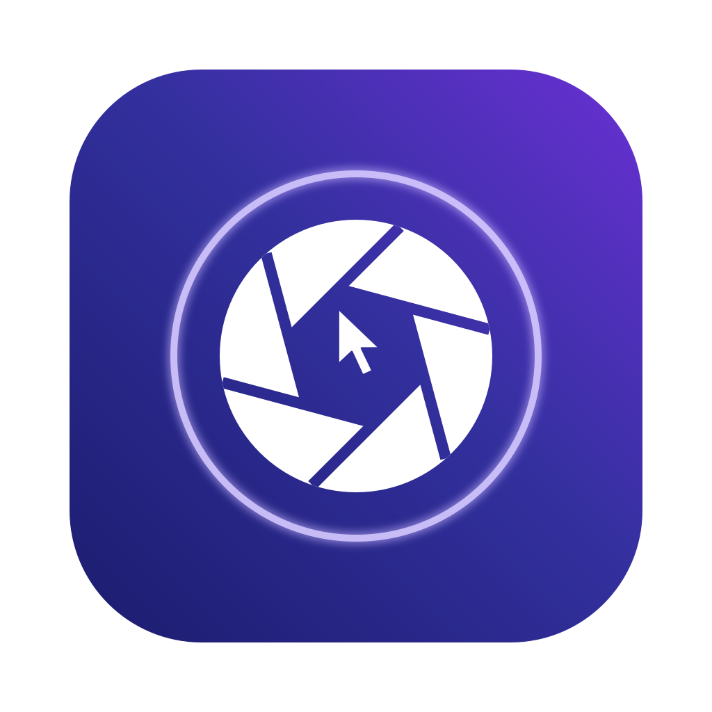
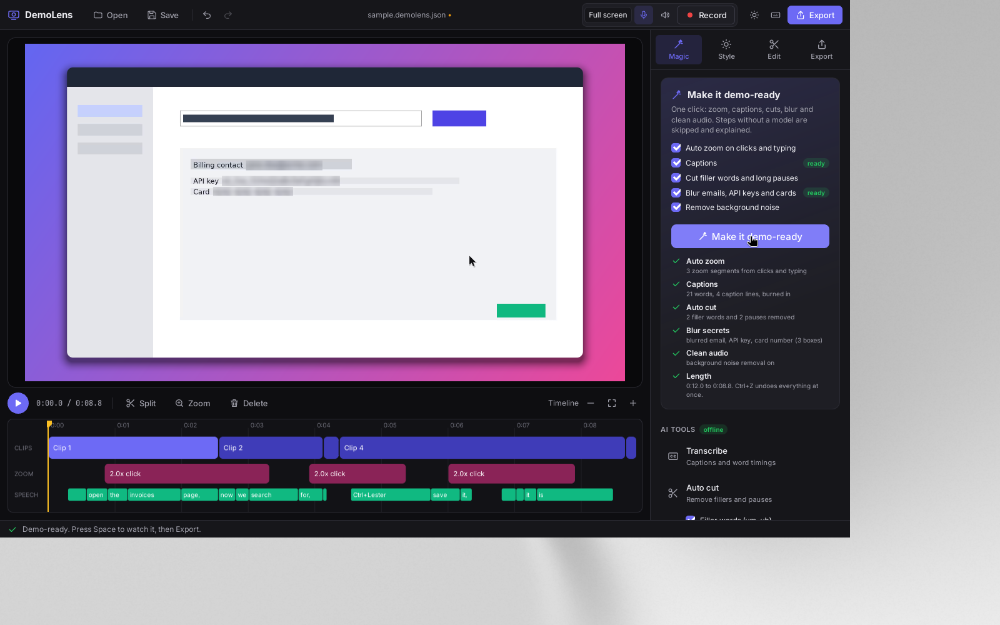
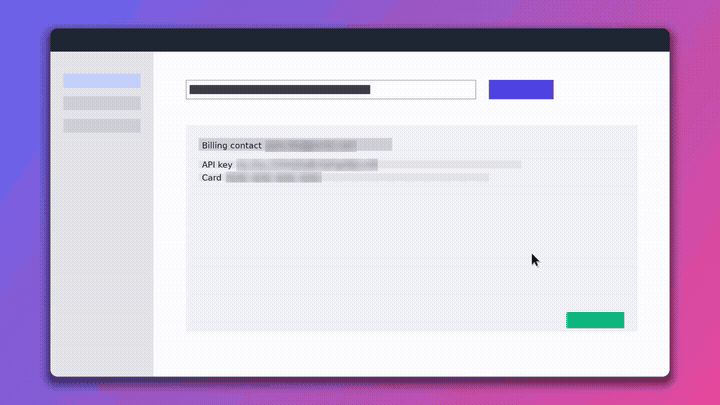
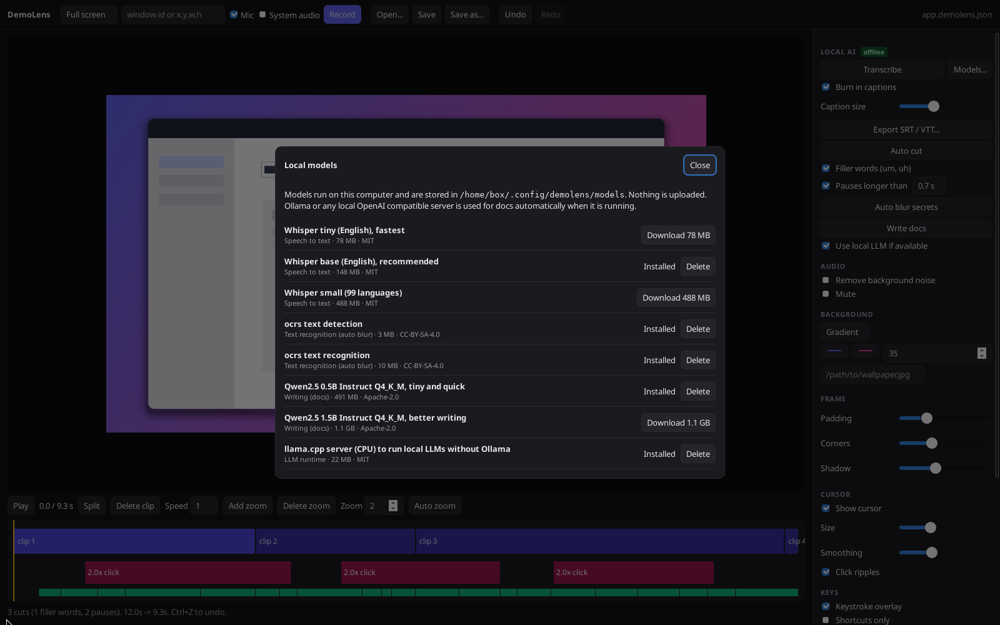
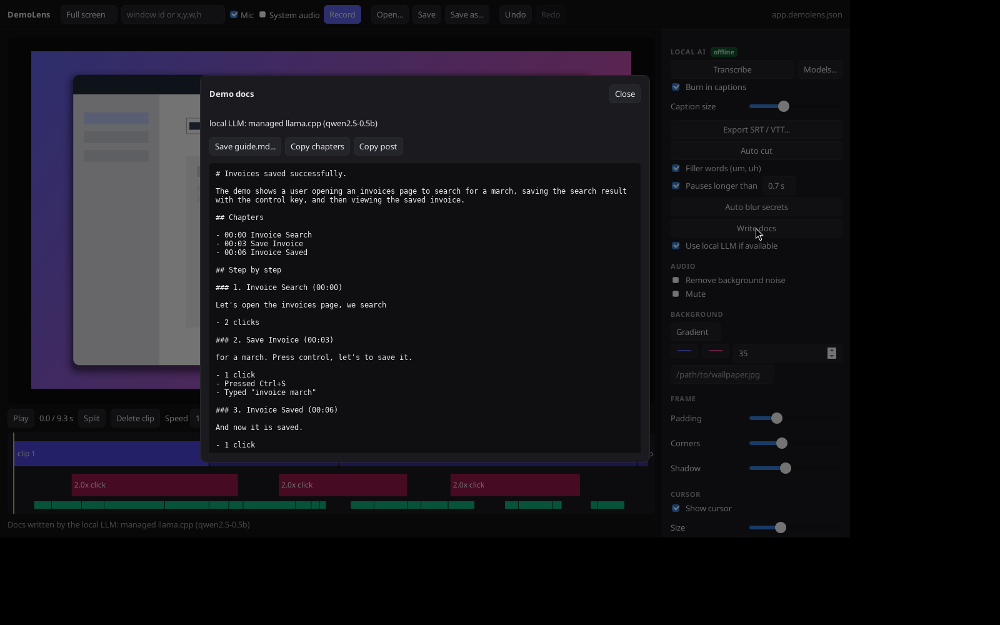

<p align="center"></p>

<h1 align="center">DemoLens</h1>

DemoLens is a free, open source screen recorder for product demos. It is a local alternative to Screen Studio and Screen Charm that runs on Windows, macOS and Linux. Everything happens on your machine: no account and no telemetry. The only network use by default is downloading the optional AI models when you ask for them. Cloud AI and uploads exist but are off until you turn them on.

You record your screen, DemoLens logs your cursor, clicks and key presses next to the video, and the editor turns that into a polished demo with smooth auto zoom, a nicer cursor, click ripples, a keystroke overlay and a styled background. Export to MP4 or GIF up to 4K in 16:9, 9:16 or 1:1.




## Quick start

1. Download the installer for your OS from [Releases](https://github.com/im45145v/DemoLens/releases) (`.msi` or `.exe` on Windows, `.dmg` on macOS, `.deb` or `.AppImage` on Linux). ffmpeg is included, so there is nothing else to install.
2. Open DemoLens and click **Try the sample**, or **Record screen**.
3. Click **Make it demo-ready**. It adds zooms, captions, cuts filler words and pauses, blurs secrets and cleans the audio. Each step says what it did, and Ctrl+Z undoes all of it.
4. Pick a template in **Style**, then a destination in **Export** (YouTube, X, Reels, a README GIF).

Press `?` in the app for all keyboard shortcuts.

DemoLens looks for ffmpeg in this order: the copy bundled with the app, your PATH, then common folders such as `/opt/homebrew/bin`, `/usr/local/bin` and `/usr/bin`. If none works, it shows the one line install command for your OS (`brew install ffmpeg`, `winget install Gyan.FFmpeg` or `sudo apt install ffmpeg`). Licenses for the bundled ffmpeg are in [THIRD_PARTY_NOTICES.md](THIRD_PARTY_NOTICES.md) and in the app under About.

### Opening DemoLens on macOS

The macOS app is signed ad hoc, not with a paid Apple Developer ID, so Gatekeeper blocks it the first time. Use any one of these:

- Right click (or Control click) DemoLens in Applications, choose **Open**, then **Open** again.
- Or try to open it once, then go to **System Settings > Privacy & Security** and click **Open Anyway**.
- Or, if macOS says the app "is damaged and can't be opened", run this in Terminal and open it again:

  ```sh
  xattr -cr /Applications/DemoLens.app
  ```

  This removes the download quarantine flag that your browser added. The app is not actually damaged.

The first time you record, macOS asks for **Screen & System Audio Recording** and, with the mic on, **Microphone** access. Allow both, then quit and reopen DemoLens if macOS asks you to. You can change this later in System Settings > Privacy & Security.

## Why DemoLens

| | DemoLens | Screen Studio | Cap | Loom / Tella |
|---|---|---|---|---|
| Price | Free, MIT | Paid | Free core, paid cloud | Subscription |
| Windows, macOS, Linux | All three | macOS only | macOS, Windows | Browser and desktop |
| AI captions and cuts | Offline, on your machine | No | Cloud | Cloud |
| Auto blur of API keys, emails, cards | Yes | No | No | No |
| Scriptable CLI | Yes | No | No | No |

If you record demos of developer tools, your screen is full of tokens, emails and customer data. DemoLens finds and blurs them for you and never uploads a frame unless you set up your own storage.


## Features

- **Recording**: full screen, a single window or an area, with microphone and system audio where the OS allows it (see the capture table below).
- **Event log**: while recording, cursor moves and clicks are written to a timestamped `*.events.jsonl` file next to the video. Key capture is off by default; when you turn it on, only shortcut names and the timing of typing are kept, never the characters.
- **Recording indicator**: an always on top REC badge with a timer and a Pause button (Ctrl/Cmd+Shift+P). Paused parts are cut.
- **Webcam overlay**: record the webcam alongside the screen and show it as a circle or rounded square in any corner, or in a column beside the screen. Optional mirror. It shows in the editor preview, not only in the export.
- **Auto zoom**: zoom segments are generated from clicks and typing bursts. The zoom eases in and out smoothly, anticipates where the action will be, and holds still while the cursor wanders inside a dead zone (the Steadiness slider). Subtle, moderate and intense zoom styles are one click. Every segment is visible on the timeline, where you can drag its edges, change its scale, delete it or add new ones.
- **Cursor**: cursor smoothing, a bigger cursor option and click highlight ripples. DemoLens hides the OS cursor while recording and draws its own, so it stays sharp at any zoom.
- **Keystroke overlay**: shows shortcuts such as `Ctrl + S`, and "Typing..." while you type. Shortcuts only by default.
- **Styling**: gradient, solid or your own photo as the background (png, jpg, heic, webp; fit, fill or blur, dim; copied into the project folder), padding, rounded corners, a soft shadow, an optional text watermark, twelve built-in wallpapers, intro and outro title cards, timed text callouts and drawn shapes (arrow, box, ellipse, highlight).
- **Interactive demo**: `demolens interactive demo.json` (or Magic tab) turns a recording into one self-contained HTML click-through, built from the event log, with blur boxes applied and no network calls. Share it with a signed link to your own bucket.
- **Editing**: trim, split, delete pieces and set per clip speed (0.25x to 16x, audio follows).
- **Blur boxes**: draw blur regions with the mouse on the frame; they move correctly with the zoom. A visual picker lets you drag the area to record on a screenshot.
- **Templates and presets**: start from built in looks (Sunset, Midnight, Ocean, Clean light, Minimal, Social card) or save a brand style per product (background, frame, cursor, keys) and reapply it to any recording.
- **Make it demo-ready**: one button (or `D`, or `demolens ready`) runs zoom, captions, cuts, blur and noise removal and reports each step.
- **Editor comforts**: dark and light themes, undo and redo, a timeline you can zoom and scrub, draggable zoom segments, keyboard shortcuts for everything (press `?`). Opening a video also loads the event log next to it.
- **Local AI** (optional, offline, see below): captions, auto cut of filler words and long pauses, auto blur of emails, API keys and card numbers, and written docs (title, chapters, step by step guide, social post).
- **Audio cleanup**: background noise removal and mute.
- **Export**: MP4 (H.264 + AAC), WebM (VP9 + Opus) or GIF (palette optimised), 480p to 4K, in 16:9, 9:16 or 1:1, with presets for YouTube, Reels and Shorts, feed posts and READMEs. An untouched recording is remuxed without re-encoding.
- **Optional cloud AI and storage**: bring your own key for OpenAI, Anthropic, Gemini, Groq, OpenRouter, Deepgram, AssemblyAI, ElevenLabs or any OpenAI compatible endpoint, and your own S3 or R2 bucket. Off by default; see [Cloud AI](#cloud-ai-optional).

## How it works

DemoLens uses the Mac media engine for encoding where it can and avoids work it does not need. See [docs/EFFICIENCY.md](docs/EFFICIENCY.md) for what it does and the measured numbers.

```
 record                       edit                                   export
 ┌──────────────┐   video     ┌────────────────────────────────┐     ┌──────────────┐
 │ OS grabber   │──────────▶  │ project.json                   │     │ ffmpeg       │
 │ (via ffmpeg) │             │  clips, zoom, style, blur ...  │     │ libx264/gif  │
 └──────────────┘             └──────────────┬─────────────────┘     └──────▲───────┘
 ┌──────────────┐  events     ┌──────────────▼─────────────────┐  RGBA      │
 │ input hooks  │──────────▶  │ Renderer::render(frame, t)     │────────────┘
 │ (rdev)       │  .jsonl     │  one compositor in Rust        │──▶ PNG ──▶ editor preview
 └──────────────┘             └────────────────────────────────┘
```

The important design choice is that there is **one render path**. The editor preview and the exporter both call `Renderer::render` in `demolens-core`, so the preview is exactly what you will export. The web UI never draws video pixels itself; it only edits the project and shows frames rendered by Rust.

Repository layout:

| Path | What it is |
|------|------------|
| `crates/demolens-core` | The engine. `events` (event log format, cursor track and smoothing), `zoom` (auto zoom generation and the eased camera), `render` (compositor: background, shadow, rounded frame, zoomed video, blur, cursor, ripples, key overlay), `export` (decode, render, encode), `ffmpeg` (probe and pipes), `project` (timeline model with trim, split and speed), `preset`, `capture` (per OS backends) and `input` (global hooks). |
| `crates/demolens-cli` | The `demolens` command line tool. Everything the editor does can be scripted. |
| `src-tauri` | The Tauri 2 desktop app. Thin command layer over the core. |
| `ui` | Plain HTML, CSS and JS editor. No bundler, no Node needed. |

The renderer is plain Rust on the CPU, parallelised over rows with rayon. On an 8 core box it exports the 12 second 1080p sample in about 6 seconds and 4K in about 23 seconds.

### Event log format

JSON Lines. The first line is a header, then one event per line. Times are milliseconds since the first video frame and coordinates are in video pixels.

```json
{"demolens_events":1,"width":1920,"height":1080,"origin_x":0,"origin_y":0,"scale":1.0}
{"t":1203.5,"kind":"move","x":160.0,"y":232.0}
{"t":1350.0,"kind":"click","x":160.0,"y":232.0,"button":"left"}
{"t":5200.0,"kind":"key","key":"i","modifiers":[]}
{"t":7000.0,"kind":"key","key":"S","modifiers":["Ctrl"]}
```

### Auto zoom

Clicks and typing bursts (3 or more keys with less than 0.9 s between them; shortcuts do not count) become activity points. Points closer than 1.8 s are grouped. Each group becomes a segment that starts 0.5 s before the first event and holds 1.4 s after the last one, with a minimum length and clamping to the video. Overlapping segments are merged. At render time the camera eases in and out with a cubic curve, follows the smoothed cursor, and is clamped so the zoomed view never leaves the frame. All of this is covered by unit tests in `crates/demolens-core/src/zoom.rs`.

## Local AI

By default all AI features run on your own machine. Nothing is sent anywhere, and nothing is downloaded until you ask for it (models come from Hugging Face, GitHub and AWS and are SHA-256 checked). Without any model installed, DemoLens works exactly as before and each AI button tells you which model it needs.

Open **Models...** in the app (or run `demolens models list`) to see, download and delete models. They live in `~/.config/demolens/models` (the platform config folder on macOS and Windows). Once downloaded, everything works with no network.

| Model | Size | Used for | License |
|-------|------|----------|---------|
| Whisper tiny.en | 78 MB | captions, filler detection (fastest) | MIT |
| Whisper base.en | 148 MB | captions (recommended) | MIT |
| Whisper small | 488 MB | captions in 99 languages | MIT |
| ocrs detection + recognition | 13 MB | finding secrets on screen for auto blur | CC-BY-SA-4.0 |
| Qwen2.5 0.5B Instruct Q4 | 491 MB | writing docs (quick) | Apache-2.0 |
| Qwen2.5 1.5B Instruct Q4 | 1.1 GB | writing docs (better) | Apache-2.0 |
| llama.cpp server | 22 MB | runs the Qwen models when you have no Ollama | MIT |

What each feature does:

- **Transcribe and captions**: whisper.cpp with word timestamps. Words are snapped to the real speech using silence detection. Captions can be burned in (with size control) or exported as SRT or VTT. Words you cut never show up.
- **Auto cut**: removes filler words (um, uh) and pauses longer than a threshold you choose. Each cut is a normal clip edit, so undo works.
- **Auto blur secrets**: samples frames (skipping frames that did not change), reads them with OCR and adds blur boxes over emails, API keys (`sk_live_...` and similar), bearer tokens, card numbers (Luhn checked), phone numbers, Aadhaar (Verhoeff checked), PAN, UPI IDs, IBANs (mod 97), IP addresses and password fields. It can miss text: watch the export before sharing.
- **Write docs**: builds steps from the transcript, clicks, typing and zooms, then writes a title, YouTube style chapters, a Markdown guide and a short social post. With no LLM it falls back to a rule based writer.

The LLM is found in this order: `DEMOLENS_LLM_URL` (any OpenAI compatible server, this machine only unless you also set `DEMOLENS_ALLOW_REMOTE_LLM=1`, in which case it must be https and the app asks first), Ollama on port 11434, a server on port 8080, then the bundled llama.cpp runtime with a downloaded Qwen model.

Honest limits: Whisper often drops filler words or writes them as real words, so auto cut finds fewer fillers than a human would. The 0.5B model writes plain but usable text; the 1.5B model or your own Ollama model writes better.







## Cloud AI (optional)

Off by default. Open **Settings > Cloud AI**, paste your own key (stored in the OS keychain, shown masked, removable) and tick a task for a provider. Ticking shows a notice that the data leaves your device and records the date. Every call then shows exactly what is sent, its size, the provider, the endpoint and links to their terms and privacy policy, and you can cancel.

| Provider | Speech to text | Writing docs | Text to speech |
|----------|---|---|---|
| OpenAI | yes | yes | yes |
| Anthropic | | yes | |
| Google Gemini | | yes | |
| Groq | yes | yes | |
| OpenRouter | | yes | |
| Deepgram | yes | | |
| AssemblyAI | yes (deleted after transcription) | | |
| ElevenLabs | yes | | yes |
| Any OpenAI compatible endpoint (https) | yes | yes | yes |

Speech to text sends only the audio track as 16 kHz mono WAV. Writing sends only the transcript and chapter timings. Video and event logs are never sent.

**Storage:** in **Settings > Storage**, add an S3 or Cloudflare R2 bucket. After an export, "Upload and copy a private link" uploads the video as a private object (encrypted at rest on S3) and copies a signed link that expires after 24 hours by default (7 days at most). Event logs and project files are refused.

These integrations are tested against mocked HTTP servers. They follow each provider's public API, but not every provider has been tried live.

## Privacy

DemoLens runs on your computer. There is no account, no telemetry, no analytics and no crash reporting.

- **What it records:** your screen, and your microphone, system audio and webcam only if you turn them on. If you turn on key capture, it records which shortcuts you press and when you type, not the characters you type. Cursor moves and clicks are logged for auto zoom. A REC badge is always visible while recording.
- **Where it goes:** `Videos/DemoLens/` on your computer, in folders only you can read. Settings > Privacy can delete old recordings automatically or everything at once.
- **Network use:** only when you download AI models (from Hugging Face, GitHub and AWS), or when you turn on a cloud provider or your own storage, which show what will be sent first. If you set `DEMOLENS_ALLOW_REMOTE_LLM=1`, transcript text is sent to the server you choose.
- **Auto blur helps but is not perfect.** Always watch your export before sharing.
- **Recording other people:** if your screen, mic or calls include other people, you are responsible for telling them and having a lawful reason under laws such as GDPR or India's DPDP Act.

See [PRIVACY.md](PRIVACY.md) for details and [SECURITY.md](SECURITY.md) to report a problem.

## Capture support

| OS | Video | Microphone | System audio | Input log |
|----|-------|------------|--------------|-----------|
| Linux (X11) | ffmpeg `x11grab`: screen, window (by X id), area | PulseAudio / PipeWire | Pulse monitor source | rdev (XRecord) |
| Linux (Wayland) | Not supported yet: use an X11 session. Planned: xdg-desktop-portal ScreenCast + PipeWire | | | |
| macOS (12.3+) | ScreenCaptureKit: screen, area, window, picked visually (live previews need macOS 14+; `demolens sources --thumbs dir` shows what the picker sees). Frames go to ffmpeg; the DemoLens window and REC badge are left out | avfoundation (audio only) | TODO: SCStream audio (or a loopback device such as BlackHole) | CoreGraphics pointer poller (no Accessibility permission). Keys: opt-in, class-only poller that needs Input Monitoring (0.3.0, not yet tested on a real Mac) |
| Windows | ffmpeg `gdigrab`: screen, window (by title), area | dshow (set `DEMOLENS_MIC`) | TODO: WASAPI loopback | rdev |

Native GPU capture on Windows (Windows.Graphics.Capture) and system audio on macOS are stubbed with clear TODOs in `crates/demolens-core/src/capture/`.

### Is capture working? `demolens doctor`

```bash
demolens doctor            # prints JSON, exit code 1 if the test capture failed
demolens doctor --seconds 5
```

It reports the Screen Recording permission, the displays ScreenCaptureKit sees (macOS), the ffmpeg in use, and a short test capture (file size, frame count, resolution). `next_steps` says what to fix. On macOS the permission belongs to the app that launched the command, so allow your terminal under System Settings > Privacy & Security > Screen & System Audio Recording.

The macOS build is ad-hoc signed, so each update is a new app identity to macOS. If recording stops after an update, remove DemoLens from the Screen Recording list, add it again, and reopen the app.

## Building

You need Rust 1.88 or newer (`rustup` recommended) and `ffmpeg` plus `ffprobe` on your `PATH` (or point `DEMOLENS_FFMPEG` and `DEMOLENS_FFPROBE` at them).

### Linux (Debian / Ubuntu)

```sh
sudo apt install ffmpeg x11-utils pkg-config libwebkit2gtk-4.1-dev libgtk-3-dev \
  librsvg2-dev libxdo-dev libssl-dev libx11-dev libxtst-dev libxi-dev \\
  cmake clang libclang-dev   # cmake and clang build whisper.cpp
cargo build --release                       # CLI: target/release/demolens
cargo build --release -p demolens-app       # desktop app: target/release/demolens-app
```

Fedora: `sudo dnf install ffmpeg webkit2gtk4.1-devel gtk3-devel librsvg2-devel libxdo-devel openssl-devel libXtst-devel libXi-devel`.

### macOS

```sh
xcode-select --install
brew install ffmpeg cmake
cargo build --release -p demolens-app
```

Grant Screen Recording and Accessibility permission to the app (or your terminal) the first time you record.

### Windows

Install the Visual Studio C++ Build Tools and WebView2 (preinstalled on Windows 11), then:

```powershell
winget install Gyan.FFmpeg
winget install Kitware.CMake LLVM.LLVM   # for whisper.cpp
cargo build --release -p demolens-app
```

To build installers (`.deb`, `.AppImage`, `.dmg`, `.msi`) install the Tauri CLI with `cargo install tauri-cli --version "^2"` and run `cargo tauri build` inside `src-tauri`.

## Usage

Desktop app:

```sh
target/release/demolens-app                      # empty editor, use Record or Open
target/release/demolens-app my.demolens.json     # open a project
```

Command line:

```sh
demolens record --area 0,0,1920,1080 --mic --system-audio --out rec   # Enter to stop
demolens new rec/recording.mkv -o demo.json        # probe, load events, auto zoom
demolens trim demo.json 500 11500
demolens split demo.json 7500
demolens speed demo.json 1 2
demolens blur demo.json 420,300,600,200
demolens preview demo.json --at 3000 -o frame.png
demolens export demo.json -o demo.mp4 --aspect 9:16 --quality 2160
demolens export demo.json -o demo.gif --aspect 1:1 --quality 480 --fps 15
demolens preset save demo.json "Acme"     # later: demolens preset apply other.json "Acme"
```

Try the whole pipeline without recording anything:

```sh
demolens sample samples          # synthetic app video + event log + project
demolens export samples/sample.demolens.json -o demo.mp4
```

Local AI from the command line:

```sh
demolens models list
demolens models download whisper-base.en
demolens transcribe demo.json
demolens captions demo.json -o demo.srt          # or --burn --size 48
demolens autocut demo.json --pause 0.7
demolens redact demo.json
demolens docs demo.json -o docs/                 # --no-llm for the rule based writer
demolens audio demo.json --denoise
demolens ready demo.json                         # all of the above in one go
demolens sample samples --speech                 # sample with espeak-ng narration and fake secrets
```

Run the tests with `cargo test -p demolens-core -p demolens-ai`.

## Roadmap

Done: drawn blur boxes, a visual area picker, webcam overlay, optional cloud AI and storage, one click demo-ready, templates, new editor layout and timeline, shortcuts, installers for all OSes, local captions, auto cut, auto blur of sensitive text, noise cleanup, local docs writer, undo and redo, native file dialogs.

- Bundled ffmpeg and signed builds.
- Wayland capture through the PipeWire portal (Wayland is not supported yet; use an X11 session).
- Intel Mac builds. The release ships Apple Silicon only; Intel Macs can build from source with `cargo build --release --target x86_64-apple-darwin`.
- Local AI voiceover with Piper, to replace or fix narration.
- Loudness normalisation for the mic track.
- System audio on macOS through SCStream, and Windows.Graphics.Capture plus WASAPI loopback (Windows).
- GPU rendering (wgpu) for faster 4K export and live playback in the editor.
- Motion blur on zoom transitions and cursor.

## License

MIT. Copyright (c) 2026 Ashish Malla ([@im45145v](https://github.com/im45145v)).
