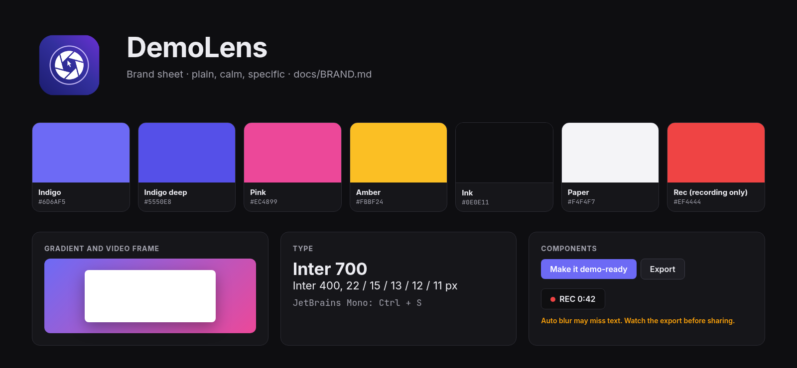

# DemoLens brand guidelines

## Name
Always **DemoLens**: one word, capital D and L. Never "Demolens", "Demo Lens" or "DL". The CLI command is `demolens` in lower case.

## Voice
Plain, calm and specific. Say what happened and what to do next. Short sentences, no hype, no exclamation marks, no em dashes. Privacy claims must be exact ("runs on this computer unless you turn on a cloud provider"), never absolute when they are not.

## Logo
The app icon (`src-tauri/icons/icon.png`): a lens aperture on an indigo to violet rounded square. Keep clear space of at least a quarter of the icon width around it. Do not recolour, stretch, outline or put it on busy photos. The in-app mark is the outline glyph `i-logo` in `ui/index.html`.

## Colour
These are the tokens at the top of `ui/style.css`; all UI colours derive from them.

| Token | Hex | Use |
|-------|-----|-----|
| `--brand-indigo` | `#6D6AF5` | Primary actions, focus, selected clips (dark theme) |
| `--brand-indigo-deep` | `#5550E8` | Primary in the light theme, text links |
| `--brand-pink` | `#EC4899` | Zoom segments, drawn blur boxes, gradient end |
| `--brand-amber` | `#FBBF24` | Playhead, warnings |
| `--brand-ink` | `#0E0E11` | Dark background, text on light |
| `--brand-paper` | `#F4F4F7` | Light background |
| `--brand-rec` | `#EF4444` | Recording only (REC badge, Stop) |

The brand gradient is `linear-gradient(135deg, #6D6AF5, #EC4899)` and is also the default video background. Red is reserved for recording and destructive actions. Text contrast must meet WCAG AA (4.5:1).

## Type
UI: Inter, falling back to the system UI font. Code and keys: JetBrains Mono, falling back to the system monospace. Sizes: 11, 12, 13, 15 and 22 px. Weights 400, 600 and 700.

## Shape and spacing
Spacing on a 4 px grid (4, 8, 12, 16, 24, 32). Radii 6, 8, 12 and 16 px. Soft shadows only.

## In videos
Exports default to the brand gradient with 6% padding, rounded corners and a soft shadow, an enlarged smoothed cursor and white captions on a dark pill. Save your own product look as a template rather than changing these defaults.
